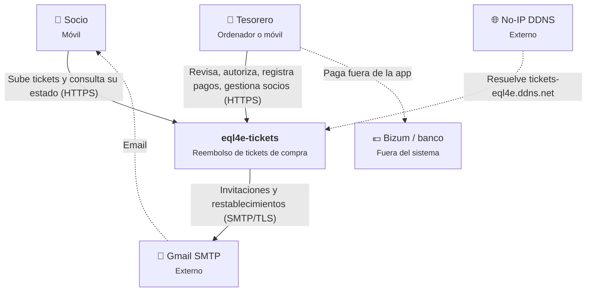
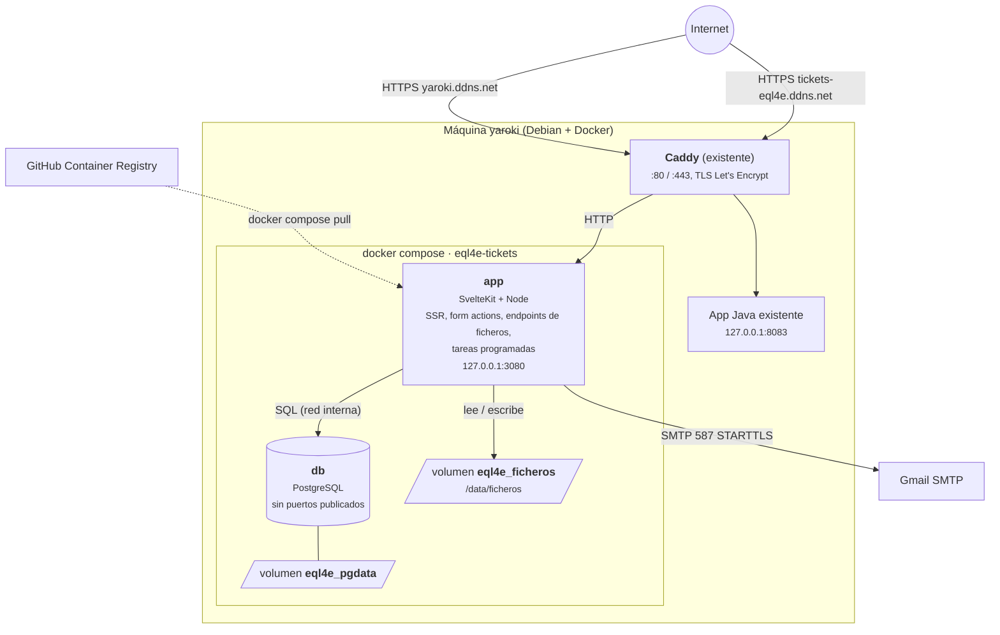
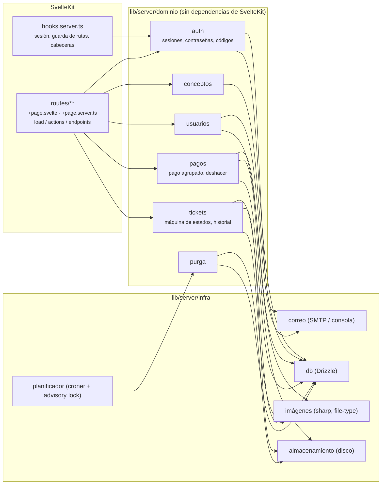

# 01 · Diagramas C4

## Nivel 1 · Contexto

## Nivel 2 · Contenedores (despliegue en la máquina)

## Nivel 3 · Componentes de la app

**Regla de dependencias**: `routes` → `dominio` → `infra`. El dominio no importa nada de `$app/*` ni de `@sveltejs/kit`. Se puede comprobar en la CI con una regla de ESLint (`no-restricted-imports`).
