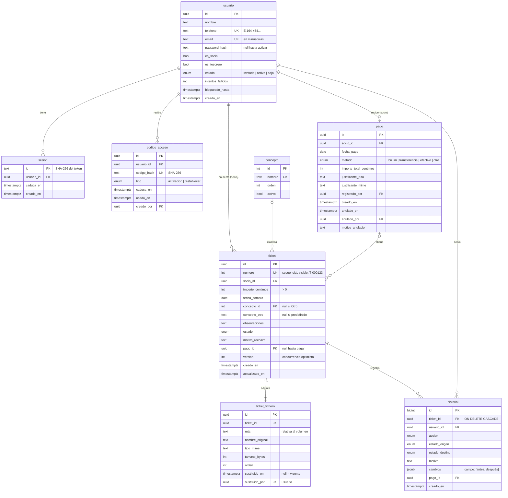

# 02 · Modelo de datos

Los nombres de tablas y columnas van en español y en `snake_case`. Todas las fechas y horas son `timestamptz`.

## Diagrama

## Enumerados

- `estado_ticket`: `pendiente_autorizar`, `rechazado`, `pendiente_pago`, `pagado`, `anulado`.
- `accion_historial`:
  - Del socio: `crear`, `editar`, `anular`, `reenviar`.
  - Del tesorero: `autorizar`, `rechazar`, `pagar`.
  - Deshacer: `deshacer_autorizacion`, `deshacer_rechazo`, `deshacer_pago`.

## Restricciones e índices relevantes

| Regla | Implementación |
|---|---|
| Concepto obligatorio: predefinido **u** "Otro" | `CHECK ((concepto_id IS NULL) <> (concepto_otro IS NULL))` |
| Importe positivo | `CHECK (importe_centimos > 0)` |
| Un ticket pagado tiene pago, y solo él | `CHECK ((estado = 'pagado') = (pago_id IS NOT NULL))` |
| Rechazado ⇒ motivo | `CHECK (estado <> 'rechazado' OR motivo_rechazo IS NOT NULL)` |
| Un pago agrupa tickets de **su** socio (E-02) | Validado en el servicio dentro de la transacción (no se puede expresar con un `CHECK` simple) |
| Historial inmutable | El código solo hace `INSERT`. *Opcional:* un `TRIGGER` que rechace `UPDATE` y `DELETE` salvo el borrado en cascada de la purga |
| Listado del tesorero rápido (RNF-41) | Índices en `ticket(estado, creado_en)`, `ticket(socio_id)`, `ticket(fecha_compra)` |
| Purga (HU-G05) | Índice en `ticket(fecha_compra)`; borra el `ticket` y por cascada `ticket_fichero` e `historial`; borra el `pago` sin tickets; borra los ficheros del disco después del `COMMIT` |

## Notas de diseño

- **Implementación** (2026-11-05): [esquema.ts](../../src/lib/server/infra/db/esquema.ts) y las migraciones de [drizzle/](../../drizzle). En TypeScript los nombres van en camelCase; Drizzle los traduce a snake_case (`casing`).
- **Restricciones añadidas al implementar**: email en minúsculas; un usuario *activo* tiene contraseña; al menos un rol; longitudes de `concepto_otro` (1–100) y `observaciones` (≤ 500); `sustituido_en` y `sustituido_por` van juntos; la anulación del pago (`anulado_en`, `anulado_por`, `motivo_anulacion`) va completa; el justificante lleva ruta y tipo juntos.
- **Historial inmutable**: un *trigger* rechaza cualquier `UPDATE`. El `DELETE` se permite para la purga en cascada.
- **`codigo_acceso.creado_por`** es nulo cuando lo genera el sistema (tesorero inicial, R-06).

- **Ordenar por concepto**: `COALESCE(concepto.nombre, ticket.concepto_otro)`.
- **El motivo de rechazo** está en `ticket` (el último, para mostrarlo con facilidad) y en `historial` (todos).
- **El pago anulado no se borra** (E-03): sus tickets vuelven a `pendiente_pago` con `pago_id = NULL`. El pago queda con `anulado_en` y el historial de cada ticket apunta a él.
- **Ficheros sustituidos al editar o reenviar**: **no se borran**. La fila se marca con `sustituido_en` y `sustituido_por`, y el fichero sigue en el disco. El ticket muestra solo los vigentes (`sustituido_en IS NULL`); el historial enlaza los sustituidos, así que el tesorero puede ver la foto que motivó un rechazo. Solo la purga (HU-G05) los elimina.
- **Al menos un fichero vigente por ticket**: se valida en el servicio, porque no se puede expresar con un `CHECK`.
- **`numero` visible** (`T-000123`): se genera con una secuencia. Es lo que se usa para hablar de un ticket ("el T-123"); nunca se expone el UUID en la interfaz.
- **Un socio dado de baja** conserva sus tickets y aparece como "(baja)" en los listados.
