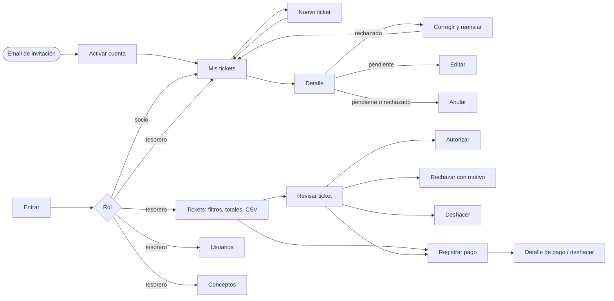

# Diseño · eql4e-tickets

> Estado: **v1.0 aprobada** · 2026-11-04

- **Bocetos navegables**: [bocetos.html](bocetos.html). Se ven mejor publicados como artifact (enlace en la conversación de la Tarea 3).
- **Logo**: [../imagenes/eql4e.png](../imagenes/eql4e.png)

## Mapa de navegación

## Guía visual

### Principio

El logo es monocromo, así que **la marca es la tinta del logo** (negro en tema claro, casi blanco en tema oscuro): botones principales, navegación y selección. **El color se reserva para los estados del ticket**, para que se distingan de un vistazo y nunca compitan con la marca.

### Estados

| Estado | Color | Icono | Uso |
|---|---|---|---|
| Pendiente de autorizar | Ámbar | Reloj | Requiere acción del tesorero |
| Pendiente de pago | Azul | Euro | Se debe dinero al socio |
| Pagado | Verde | Check | Cerrado |
| Rechazado | Rojo | Aspa | Requiere acción del socio |
| Anulado | Gris | Círculo tachado | Final |

Cada estado lleva siempre **color + icono + texto** (accesibilidad, RNF-42). Los colores concretos de tema claro y oscuro están como variables CSS en `bocetos.html` y pasarán a ser el tema de Tailwind.

### Tipografía

| Rol | Fuente | Uso |
|---|---|---|
| Títulos | Bricolage Grotesque | Solo titulares de pantalla y sección |
| Texto | Atkinson Hyperlegible | Texto, formularios, botones. Diseñada para máxima legibilidad (socios de cualquier edad) |
| Datos | IBM Plex Mono | Números de ticket, importes, fechas. Cifras de ancho fijo, como en un ticket de caja |

Las tres son libres (licencia OFL) y se **alojarán en la propia app** (sin llamar a Google Fonts en producción, RNF-23).

### Formatos

| Dato | Formato |
|---|---|
| Importe | `1.234,56 €` |
| Fecha | `04/11/2026` |
| Fecha y hora | `04/11/2026 20:41` |
| Número de ticket | `T-000150` |
| Teléfono | `+34 612 345 678` |

### Reglas de interacción

- Un solo botón principal por pantalla. En el móvil, la acción principal va **abajo y a todo el ancho**.
- Las acciones irreversibles o con efecto sobre otros (anular, rechazar, deshacer) piden **confirmación en la propia página** y, cuando procede, motivo.
- En el tesorero, por debajo de 1024 px la tabla pasa a lista y los filtros a una hoja inferior.
- Los mensajes de error dicen qué ha pasado y cómo resolverlo. El catálogo de mensajes clave está en la pestaña «Guía visual» de los bocetos.

## Decisiones tomadas en los bocetos (para validar)

1. **Totales del socio**: «Por autorizar», «Por cobrar» y «Cobrado en el año». Las etiquetas hablan desde el punto de vista del socio, pero las insignias de estado son las mismas en toda la app.
2. **En el detalle del tesorero, el visor de la foto ocupa la mitad de la pantalla**: comprobar la foto es la tarea principal.
3. **Atajo «Autorizar y registrar el pago»** desde el detalle: para cuando el tesorero autoriza y paga en el momento.
4. **El ticket propio del tesorero** aparece en el listado marcado como «tuyo», con las acciones desactivadas y la explicación (R-04).
5. **Se ve que «Otro» es un concepto libre** en el listado: «Otro: Floristería».
