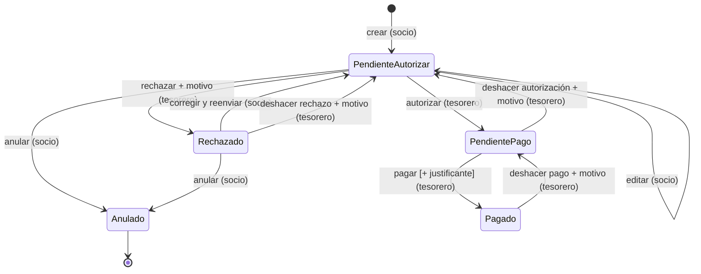

# 03 · Ciclo de vida del ticket

> Estado: **v1.0 aprobada**

## Diagrama

## Estados

| Estado | Significado | ¿Editable por el socio? |
|---|---|:-:|
| **Pendiente de autorizar** | Enviado, esperando revisión del tesorero. | ✅ editar / anular |
| **Rechazado** | El tesorero no lo acepta; tiene un motivo visible para el socio. | ✅ corregir y reenviar / anular |
| **Pendiente de pago** | Autorizado; se debe el importe al socio. | ❌ |
| **Pagado** | Abonado fuera de la app; puede tener justificante. | ❌ |
| **Anulado** | Retirado por el socio. Estado final. | ❌ |

> Se añade **Anulado** respecto al enunciado: es la forma de que el socio "anule" sin borrar datos, conservando el historial.

## Transiciones

| # | Desde → Hasta | Quién | Datos obligatorios | Notas |
|---|---|---|---|---|
| T1 | — → Pend. autorizar | Socio | ficheros, importe, fecha de compra, concepto | Ver HU-S01 |
| T2 | Pend. autorizar → Pend. autorizar | Socio (propio) | — | Edición; se registra en historial qué campos cambian |
| T3 | Pend. autorizar → Anulado | Socio (propio) | — | |
| T4 | Pend. autorizar → Pend. pago | Tesorero | — | R-04 |
| T5 | Pend. autorizar → Rechazado | Tesorero | **motivo** | |
| T6 | Rechazado → Pend. autorizar | Socio (propio) | — | Puede cambiar ficheros, importe y concepto antes de reenviar |
| T7 | Rechazado → Anulado | Socio (propio) | — | |
| T8 | Pend. pago → Pagado | Tesorero | fecha de pago, método (Bizum / transferencia / efectivo / otro) | Justificante opcional. Puede ser agrupado (ver abajo). R-04 |
| D1 | Pend. pago → Pend. autorizar | Tesorero | **motivo** | Deshacer autorización |
| D2 | Rechazado → Pend. autorizar | Tesorero | **motivo** | Deshacer rechazo |
| D3 | Pagado → Pend. pago | Tesorero | **motivo** | Deshacer pago (ver abajo) |

Cualquier otra transición se rechaza (por ejemplo, pagar un ticket no autorizado o editar uno pagado).

## Reglas

- **E-01 Historial**: toda transición (incluida la edición T2) genera una entrada inmutable: fecha y hora, usuario, estado origen, estado destino, motivo y cambios realizados. El historial nunca se edita ni se borra.
- **E-02 Pago agrupado**: un **Pago** agrupa uno o más tickets **del mismo socio**, todos en *Pendiente de pago*. Tiene fecha, método, importe total (la suma de los tickets, calculada) y un justificante opcional compartido.
- **E-03 Deshacer pago**: deshacer actúa sobre el **Pago completo**: todos sus tickets vuelven a *Pendiente de pago* y el Pago queda marcado como anulado, sin borrarse. Si solo un ticket estaba mal, se deshace el pago y se registra de nuevo con los correctos.
- **E-04 Concurrencia**: con varios tesoreros, una acción sobre un ticket cuyo estado ha cambiado desde que se cargó la pantalla se rechaza con un aviso ("otro tesorero ya lo ha modificado").
- **E-05 Un solo paso**: deshacer solo retrocede **un** paso. Para volver más atrás se deshace varias veces; cada vez queda en el historial.
